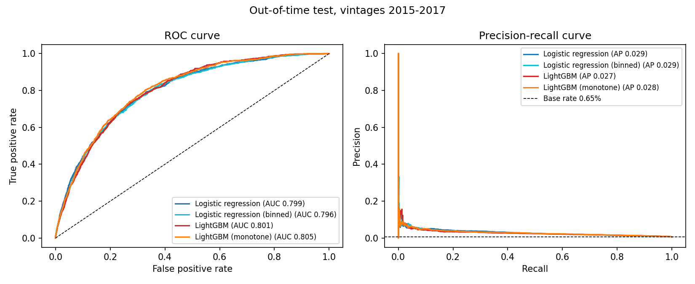
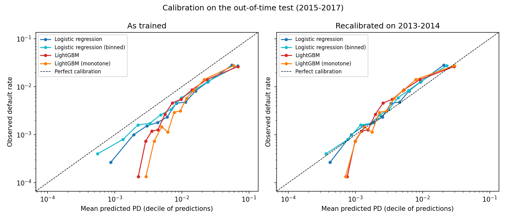
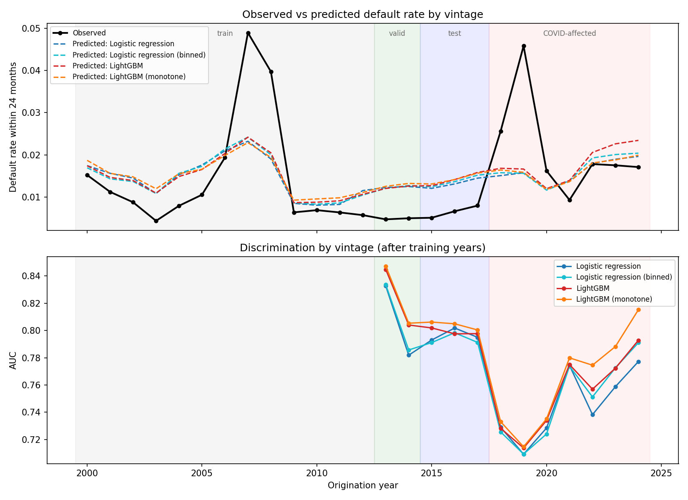
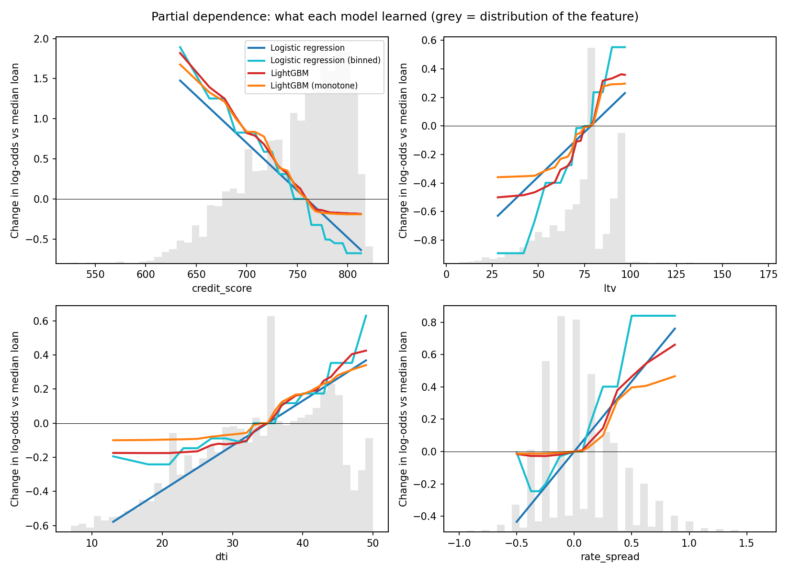
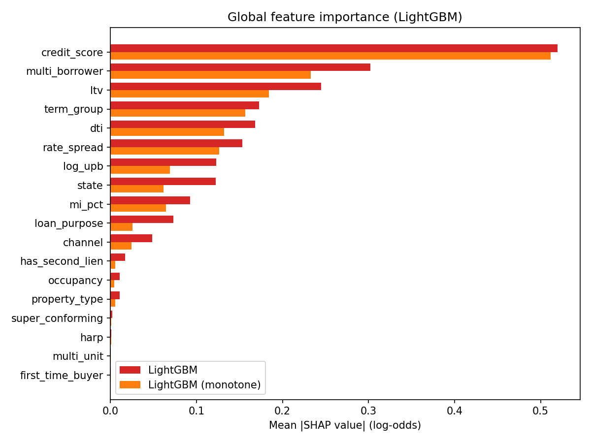
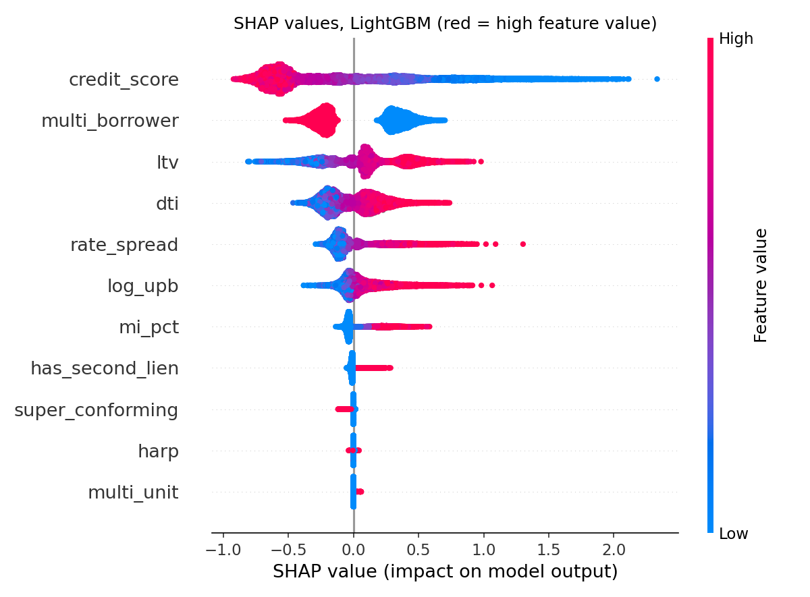
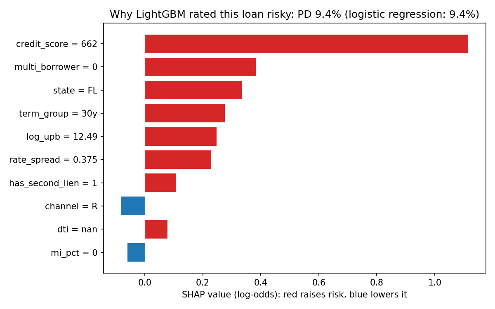

# Does gradient boosting beat logistic regression out of time?

## Question

Gradient boosting usually beats logistic regression on a random test split. But credit models are built on past loans and used on future ones, and the economy changes in between. This project asks:

1. Does gradient boosting (LightGBM) still beat logistic regression when tested **out of time**, on loans originated after the training period?
2. Is any gain large enough to justify losing a model whose every coefficient can be read off directly?

## Data

[Freddie Mac Single-Family Loan-Level Dataset](https://www.freddiemac.com/research/datasets/sf-loanlevel-dataset), sample files: a random sample of 50,000 loans per origination year (vintage), 2000–2023, with monthly performance records up to the release's performance cutoff (printed by `make_dataset.py`). The Standard Dataset covers fully amortising, fixed-rate, full-documentation mortgages acquired by Freddie Mac.

The data is free to download after registering, but may not be redistributed, so it is not in this repository (see [Reproduce](#reproduce)).

## Method

### Defining default

A loan **defaults** if, within **24 months of its first payment**, it becomes 90+ days delinquent, is acquired as real-estate owned (REO), or ends in a credit-related termination (third-party sale, short sale or charge-off, REO disposition).

- **Months on book come from the dates, not the dataset's loan-age field**, because loan age restarts after a modification.
- **The window matters.** For the 2005 vintage, 1.05% of loans default within 24 months, 2.09% within 36 and 6.36% within 60, against 11.04% at any point. Crisis-era defaults arrived late, so a short window understates pre-crisis risk. I use 24 months so that more recent vintages are fully observed; `WINDOW` in `src/config.py` can be set to 36 as a robustness check.
- **Censoring:** a loan is only used if its whole window ends before the data does. The rule depends only on the first payment date, never on what happened to the loan. Loans that prepay inside the window count as non-defaults, since they can no longer default.

### Out-of-time design

| Split | Vintages | Used for |
|---|---|---|
| Train | 2000–2012 (80%) | fitting |
| In-time test | 2000–2012 (random 20%) | the "usual" random-split benchmark |
| Validation | 2013–2014 | choosing settings, early stopping, recalibration |
| **Out-of-time test** | **2015–2017** | **the main result; untouched until evaluation** |
| Monitoring | 2018–2023 | stability over time |

The test period deliberately ends with the 2017 vintage. From 2018 onwards, 24-month windows overlap the COVID-19 forbearance period, when the delinquency status (based on the last paid instalment) can show loans in forbearance as 90+ days late. Those vintages are reported separately and flagged.

### Features

Only information known at origination, so nothing leaks the outcome:

- **Numeric:** credit score, DTI, LTV, mortgage insurance %, log loan amount, and **rate spread**, the loan's rate minus the median rate of loans from the same quarter and term. Raw interest rates mostly track the market (about 6% in 2006, 4% in 2015), so they would teach the model which year a loan came from. The spread keeps the part of pricing that reflects the borrower's risk.
- **Binary:** second lien (CLTV above LTV), more than one borrower (coded consistently despite a 2018 definition change), multi-unit property, HARP refinance, super-conforming.
- **Categorical:** occupancy, loan purpose, channel, property type, first-time buyer, state, term group.

"Not available" placeholder codes (e.g. a credit score of 9999) are converted to missing values. Fields populated only for recent years (VantageScore, property valuation method) are excluded, as are seller and servicer names and postal codes.

### Models

| Model | Interpretability |
|---|---|
| Logistic regression | One coefficient per feature (numeric features standardised, median-imputed with a missing flag) |
| Logistic regression, binned | Numeric features cut into training-set deciles, with missing values as their own bin, as in a credit scorecard: non-linear but still additive |
| LightGBM | Black box, explained with SHAP |
| LightGBM, monotone | Same settings, but risk is forced to rise with LTV, DTI and rate spread and to fall with credit score |

The binned logistic regression gives the interpretable side a fair chance by letting it capture non-linear effects. The monotone LightGBM is a middle ground that a model validator would find easier to sign off.

No resampling or class weights are used. Rebalancing would distort the predicted probabilities, and probabilities, not just rankings, are what a lender prices and provisions with. Regularisation strength (logistic regression) and tree settings (LightGBM, with early stopping) are chosen on validation AUC.

### Evaluation

- **Discrimination:** AUC and Gini, precision-recall AUC (more informative than AUC when defaults are rare), KS, and the share of defaults captured in the riskiest 10% of loans.
- **Uncertainty:** paired bootstrap (500 resamples) of the AUC gain over logistic regression.
- **Calibration:** observed/expected default rate, calibration slope, Brier score and reliability curves, before and after Platt recalibration on the validation vintages.
- **Stability:** AUC by vintage, and the population stability index (PSI) between training and test vintages.

## Results

> **TODO after the full run:** paste the main tables from `reports/results.md` here and write a short interpretation of each.





## Interpretability

> **TODO after the full run:** what SHAP and the partial dependence curves show, and where the models disagree.






## Is it worth it?

> **TODO after the full run:** the verdict, weighing the AUC gain and its confidence interval against the cost of explaining and validating a black box.

## Limitations

- **Sample and scope:** 50,000 loans per vintage from one agency's fixed-rate, full-documentation book. Results may not carry over to subprime, adjustable-rate or non-agency loans.
- **No macroeconomic variables:** the models see the borrower and the loan but not house prices or unemployment. They rank risk within a vintage but cannot anticipate a crisis, which shows up as miscalibration across vintages.
- **Fixed-window label:** prepayment is a competing risk, treated here as non-default. A survival model would use the timing information directly.
- **COVID-era labels:** forbearance can inflate 90+ day delinquency for 2018+ vintages.
- **Rate spread proxy:** the market rate is the median of sampled loans in the same quarter, not a published series such as Freddie Mac's PMMS.
- **Seasoned loans:** performance starts when Freddie Mac acquires a loan, so any delinquency before acquisition is not seen.
- **Small hyperparameter search**, chosen for speed.
- **SHAP explains the model, not causation.**

## Possible extensions

House price and unemployment covariates; a discrete-time hazard model with prepayment as a competing risk; the full dataset instead of the sample; a weight-of-evidence scorecard; a 36-month window as a robustness check.

## Reproduce

1. Register at Freddie Mac Clarity and download the **sample** files (`sample_YYYY.zip`) for 2000–2023 from the Single-Family Loan-Level Dataset page.
2. Unzip each into `data/raw/`, giving `data/raw/sample_2005/sample_orig_2005.txt` and so on. If the data lives elsewhere, set the `SFLLD_RAW_DIR` environment variable to that folder instead.
3. Run:

```bash
pip install -r requirements.txt
python src/make_dataset.py   # one row per loan, about 5-10 minutes
python src/train.py          # fits and selects the four models
python src/evaluate.py       # tables in reports/results.md, figures in reports/figures/
python src/explain.py        # SHAP, partial dependence, coefficients
```

## Project structure

```
src/
  config.py        paths, label window, vintage split
  load_data.py     reads raw files, recodes placeholders, finds first default month
  make_dataset.py  step 1: builds data/processed/loans.parquet
  features.py      feature engineering, label, censoring, split
  modelling.py     the four model pipelines
  train.py         step 2: model selection on validation vintages
  evaluate.py      step 3: discrimination, calibration, bootstrap, stability
  explain.py       step 4: SHAP, partial dependence, odds ratios
reports/           results tables and figures (committed)
data/, models/     generated locally, not committed
```
